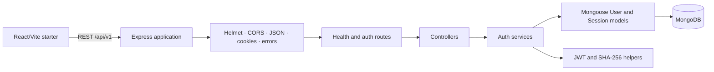

# TeamSync

**Work independently. Collaborate seamlessly. Stay in control.**

TeamSync is a collaboration and personal-productivity platform for individuals and teams. Its product vision combines personal work with multiple independent workspaces, workspace-specific roles, private projects, and secure team collaboration.

## Contents

- [Product and status](#product-and-status)
- [Technology](#technology)
- [Architecture](#architecture)
- [Repository layout](#repository-layout)
- [Local setup](#local-setup)
- [Implemented API](#implemented-api)
- [Documentation](#documentation)
- [Intellectual Property and Licensing](#intellectual-property-and-licensing)

## Product and status

The target product includes personal tasks, workspaces, invitations and roles, private projects, Kanban tasks, comments, notifications, project chat and analytics. The current repository is an early backend foundation; the frontend is a Vite starter and most product domains are not implemented.

Core product differentiators are one account for personal and team work, independent workspaces with workspace-specific roles, and projects that are private by default rather than automatically visible to every workspace member.

| Feature | Description | Status |
|---|---|---|
| Backend bootstrap | Express ES modules, config validation, MongoDB connection lifecycle | IMPLEMENTED; live DB startup not verified here |
| Health | Public `GET /api/v1/health` | COMPLETED; HTTP smoke check passed |
| Registration | Strict validation, bcrypt-backed user persistence | IMPLEMENTED; owner reports manual Postman checks |
| Login | Credential check, server-side refresh session, access token and HttpOnly cookie | IMPLEMENTED; DB-backed integration tests exist but were not run here |
| Refresh rotation | JWT/session checks, replay-family revocation, transaction-based replacement | IMPLEMENTED; integration tests exist but were not run here |
| Logout | Revoke matching refresh session and clear cookie | IMPLEMENTED; no dedicated logout test |
| Current-user endpoint | Bearer authentication and active-account check | IMPLEMENTED; no dedicated middleware/route test |
| Workspace/RBAC/projects/tasks | Multi-tenant collaboration domains | PLANNED |
| Socket.IO | Authorized real-time delivery | PLANNED |
| Frontend product UI | Router, auth UI, dashboards and API integration | PLANNED; current app is a starter |

See the [roadmap and implementation tracker](docs/08_FEATURE_ROADMAP.md) for evidence, dependencies and acceptance criteria. Status does not imply production readiness.

## Technology

| Layer | Current technology |
|---|---|
| Backend runtime/API | Node.js ES modules, Express |
| Persistence | MongoDB with Mongoose |
| Validation | Zod |
| Passwords | bcrypt |
| Tokens | jsonwebtoken (HS256) |
| HTTP security/config | Helmet, CORS, cookie-parser, dotenv |
| Frontend scaffold | React, Vite, Tailwind CSS v4 |
| Selected but not integrated frontend libraries | React Router, TanStack Query, Zustand, Axios, Lucide React |
| Automated backend integration tests | Node.js `node:test`, `node:assert/strict`; MongoDB required |

## Architecture

TeamSync uses a modular monolith: the frontend calls a versioned REST API; Express routes dispatch into controllers and services; Mongoose models persist to MongoDB. Socket.IO remains planned.



For module responsibilities and request/database/auth flows, see [System Architecture](docs/05_SYSTEM_ARCHITECTURE.md).

## Repository layout

```text
backend/src/config/       dotenv and Zod configuration
backend/src/database/     Mongoose connection
backend/src/middleware/   auth and error middleware
backend/src/modules/      auth, health, and user model
backend/src/utils/        JWT and refresh-token hash helpers
backend/tests/integration/ MongoDB transaction and auth rotation tests
frontend/src/              starter app plus scaffolding
docs/                      canonical product and engineering docs
```

## Local setup

### Prerequisites

- Node.js and npm. `backend/package.json` does not declare a supported Node version.
- A MongoDB deployment that supports transactions (replica set or sharded cluster) for refresh-rotation integration tests. MongoDB Atlas is one option; a live Atlas connection was not independently verified here.

### Backend

From `backend/`:

```powershell
Copy-Item .env.example .env
npm ci
npm run dev
```

Set `MONGO_URI`, `JWT_ACCESS_SECRET`, and `JWT_REFRESH_SECRET` in the local, ignored `.env`. The JWT secrets must each be at least 32 characters; use separate random values. `MONGO_URI` is optional in schema validation but required to connect and start the server.

For Atlas, create a cluster, a database user with only the required application privileges, and a network access rule for the development environment; then copy the driver connection string into local `MONGO_URI`. Do not put credentials in the repository or paste the URI into logs/issues. Use a separate disposable replica-set database for tests.

Available scripts are `npm run dev` and `npm start`. There is no `test` script. The DB-backed tests can be run with Node's test runner from `backend/`, after configuring a **dedicated disposable test database** in `MONGO_URI`:

```powershell
node --test tests/integration/transaction.test.js tests/integration/auth-rotation.test.js
```

The transaction test uses the database named by the URI; never point it at production or shared data. See [Testing Strategy](docs/09_TESTING_STRATEGY.md).

### Frontend

From `frontend/`:

```powershell
npm ci
npm run dev
npm run lint
npm run build
```

These are the scripts declared in `frontend/package.json`. The frontend is not yet integrated with backend auth/API.

### Environment variables

| Variable | Requirement | Purpose/default |
|---|---|---|
| `NODE_ENV` | Optional | `development`, `production`, or `test`; defaults to `development` |
| `PORT` | Optional | Positive integer; defaults to `5000` |
| `MONGO_URI` | Optional to schema; needed to start | MongoDB connection URI; no value is committed |
| `JWT_ACCESS_SECRET` | Required | Minimum 32 characters |
| `JWT_REFRESH_SECRET` | Required | Minimum 32 characters |
| `CLIENT_URL` | Optional | Valid URL; defaults to `http://localhost:5173` |
| `LOG_LEVEL` | Optional | `fatal`, `error`, `warn`, `info`, `debug`, or `trace`; defaults to `info` |

`.env.example` files contain placeholders only. Never commit `.env` or expose server values through Vite variables. Full setup details are in the [Deployment Guide](docs/10_DEPLOYMENT_GUIDE.md).

## Implemented API

All current paths are mounted beneath `/api/v1`.

| Method and path | Authentication/cookie | Behavior |
|---|---|---|
| `GET /api/v1/health` | Public | Health response |
| `POST /api/v1/auth/register` | Public | Creates a user; returns a safe DTO |
| `POST /api/v1/auth/login` | Public | Checks credentials; returns access JWT and sets refresh cookie |
| `POST /api/v1/auth/refresh` | Refresh cookie | Rotates a session and returns a new access JWT/cookie |
| `POST /api/v1/auth/logout` | Refresh cookie optional | Attempts single-session revocation; clears cookie |
| `GET /api/v1/auth/me` | Bearer access token | Returns current active user's profile DTO |

See [API Documentation](docs/07_API_DOCUMENTATION.md) for exact requests, responses, statuses and limitations. JWT/session support does not yet include CSRF or Origin protection, rate limiting, logout-all-devices, or immediate access-token revocation.

## Documentation

The [documentation index](docs/README.md) links product requirements, architecture, schema, API contracts, security, testing, deployment, ADRs and roadmap. The [Developer Guide](docs/14_DEVELOPER_GUIDE.md) describes the current implementation patterns and contribution workflow.

## Intellectual Property and Licensing

TeamSync is intended to be proprietary commercial software. This public repository does not grant general permission to reuse original TeamSync source code or other original project materials. Unauthorized copying, redistribution, modification, publication, or commercial exploitation is prohibited to the extent permitted by applicable law and subject to rights held by the relevant owners.

Third-party software and assets remain under their respective owners' licenses; the TeamSync notice does not override those terms. Commercial licensing or partnership requires prior written authorization from the designated rights holder. Ownership/contact placeholders in the draft notices must be confirmed before formal commercial use. Copyright can protect qualifying expression, but this statement does not claim ownership over a general product idea or guarantee that copying can always be prevented.

- [LICENSE](LICENSE) — draft proprietary software notice.
- [COPYRIGHT.md](COPYRIGHT.md) — ownership scope, third-party boundaries, and contribution-chain notes.
- [SECURITY.md](SECURITY.md) — draft vulnerability disclosure policy and GitHub security recommendations.
- [CONTRIBUTING.md](CONTRIBUTING.md) — approval, review, testing, and contributor-rights expectations.
- [NOTICE.md](NOTICE.md) — proprietary notice and preliminary direct-dependency license inventory.

These documents are initial drafts, not lawyer-reviewed agreements. Have them reviewed by a qualified intellectual property lawyer in India before relying on them for licensing or commercial operations.
