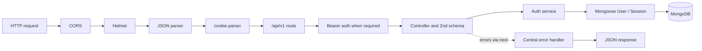

# TeamSync backend

The backend is an ES-module Node.js/Express modular monolith. It currently implements public health and auth routes, MongoDB persistence, short-lived access JWTs, HttpOnly refresh cookies, server-side refresh sessions, token rotation, replay-family revocation, bearer authentication for `/me`, and centralized error responses. Workspace authorization and full production security hardening are not implemented.

## Contents

- [Structure](#structure)
- [Request and persistence flow](#request-and-persistence-flow)
- [Dependencies and commands](#dependencies-and-commands)
- [Configuration](#configuration)
- [API](#api)
- [Authentication behavior](#authentication-behavior)
- [Tests and limitations](#tests-and-limitations)

## Structure

```text
backend/
├── src/
│   ├── app.js                         # middleware order and /api/v1 route mounts
│   ├── server.js                      # DB-first startup and signal shutdown
│   ├── config/env.js                  # dotenv + Zod environment validation
│   ├── database/connection.js         # Mongoose connection
│   ├── middleware/
│   │   ├── auth.middleware.js         # Bearer access-token authentication
│   │   └── error.middleware.js        # API error mapping
│   ├── modules/
│   │   ├── auth/                      # routes, controller, validation, service, Session model
│   │   ├── health/                    # health route/controller
│   │   └── users/                     # User model
│   └── utils/
│       ├── token.js                   # JWT sign/verify
│       └── token-hash.js              # SHA-256 refresh-token digest
└── tests/integration/                 # MongoDB transaction and auth rotation tests
```

Routes map HTTP methods/paths. Controllers validate request bodies, call services, set/clear cookies, and construct DTOs. Services implement user credential checks and session workflows. Models persist user/session state. Middleware authenticates bearer requests or converts errors to JSON. Keeping these responsibilities separate makes HTTP behavior and domain/persistence decisions easier to test.

## Request and persistence flow



The app's order is CORS, Helmet, JSON parsing, cookie parsing, health/auth routers, then the error handler. Login creates a server session before returning the access token and setting the refresh cookie. Refresh changes old/new session documents in a MongoDB transaction. The server awaits MongoDB connection before `listen`; on SIGINT/SIGTERM it closes the HTTP server then the Mongoose connection.

## Dependencies and commands

Runtime dependencies in `package.json`: `bcrypt`, `cookie-parser`, `cors`, `dotenv`, `express`, `helmet`, `jsonwebtoken`, `mongoose`, `zod`. Development dependency: `nodemon`.

| Command | Purpose |
|---|---|
| `npm ci` | Install the lockfile dependencies |
| `npm run dev` | Run `src/server.js` with Nodemon |
| `npm start` | Run `src/server.js` |
| `node --test tests/integration/transaction.test.js tests/integration/auth-rotation.test.js` | Run MongoDB integration tests |

No `test` script is declared. Integration tests require MongoDB transaction support and a dedicated test database.

## Configuration

Run commands in `backend/` so `dotenv/config` loads `backend/.env`. Copy `.env.example` to `.env`; do not commit `.env`.

| Variable | Required? | Validation / behavior |
|---|---|---|
| `NODE_ENV` | No | `development`, `production`, or `test`; default `development` |
| `PORT` | No | Positive integer; default `5000` |
| `MONGO_URI` | Schema-optional, runtime-required | Passed to `mongoose.connect`; no default |
| `JWT_ACCESS_SECRET` | Yes | At least 32 characters |
| `JWT_REFRESH_SECRET` | Yes | At least 32 characters |
| `CLIENT_URL` | No | Valid URL; default `http://localhost:5173` |
| `LOG_LEVEL` | No | Enumerated level; default `info` (not currently used by a logging framework) |

The validator does not ensure the two JWT secret values differ. Generate separate secret values in local/production secret management. `.env.example` values are placeholders, not usable credentials.

## API

All current endpoints are mounted under `/api/v1`.

| Method | Path | Auth | Behavior |
|---|---|---|---|
| GET | `/health` | None | Health response |
| POST | `/auth/register` | None | Strict registration validation; create bcrypt-hashed User |
| POST | `/auth/login` | None | Verify credentials, create Session, set refresh cookie and return access token |
| POST | `/auth/refresh` | Refresh cookie | Verify, transactionally rotate session, return new access token and cookie |
| POST | `/auth/logout` | Optional refresh cookie | Revoke matching active session when possible, clear cookie, return success |
| GET | `/auth/me` | Bearer access token | Load active user and return profile DTO |

See [API reference](../docs/07_API_DOCUMENTATION.md) for request schemas and response/error formats.

## Authentication behavior

- User passwords are bcrypt-hashed (cost 12) in a Mongoose pre-save hook. `passwordHash` is excluded by default; login explicitly selects it and uses `comparePassword`.
- Access JWTs use HS256, issuer `teamsync`, a string `sub`, `tokenType: access`, and a 15-minute expiry.
- Refresh JWTs use the separate refresh secret, issuer/type/subject claims, `sid`, and a seven-day expiry. The browser receives it as an HttpOnly cookie: `SameSite=Lax`, path `/api/v1/auth`, `Secure` only when `NODE_ENV=production`, and seven-day max-age.
- MongoDB stores a SHA-256 digest of the refresh JWT, not the raw token. Sessions track user, family, expiry, revocation, replacement and last-use timestamps. TTL cleanup is asynchronous; rotation explicitly checks `expiresAt`.
- Rotation runs in a MongoDB transaction, conditionally revokes the existing session and creates its replacement in the same family. Reuse of a revoked but otherwise matching token revokes active sessions in the family.
- Logout returns success and clears the cookie even when it is missing/invalid. A database failure is forwarded to error handling before cookie clearing. Logout does not revoke already-issued access JWTs; they can remain valid until expiry.

## Tests and limitations

Two Node built-in integration test files exist. The auth suite tests valid rotation, invalid JWT, replay-family revocation, simultaneous refresh attempts, suspended users, and explicit session expiry. The transaction suite checks commit and intentional rollback.

These tests were not run during the documentation update because they require MongoDB. Configure `MONGO_URI` to a disposable database before running: the auth suite selects `teamsync_test`, while the transaction test uses the database named in the URI and creates `teamsync_transaction_probe` there. Do not point that URI at production/shared data. Tests do not yet cover login/register endpoints, logout behavior, auth middleware, CSRF, Origin validation, or broad failure/concurrency cases.

CSRF and Origin protection, authentication rate limiting, logout-all-devices, access-token revocation, and production cookie/security-header review remain outstanding. This is not a claim of production readiness.
