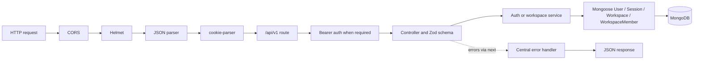

# TeamSync backend

The backend is an ES-module Node.js/Express modular monolith. It implements public health and auth routes plus authenticated workspace create/list/details/update/soft-delete routes. Auth includes MongoDB persistence, short-lived session-bound access JWTs, HttpOnly refresh cookies, server-side refresh sessions, token rotation, replay-family revocation, database session checks on `/me`, and centralized error responses. Workspace authorization currently covers membership-scoped visibility, OWNER/ADMIN updates and OWNER-only deletion; member administration and project/resource authorization are not implemented.

## Contents

- [Structure](#structure)
- [Request and persistence flow](#request-and-persistence-flow)
- [Dependencies and commands](#dependencies-and-commands)
- [Configuration](#configuration)
- [API](#api)
- [Authentication behavior](#authentication-behavior)
- [Tests and limitations](#tests-and-limitations)

## Structure

```text
backend/
├── src/
│   ├── app.js                         # middleware order and /api/v1 route mounts
│   ├── server.js                      # DB-first startup and signal shutdown
│   ├── config/env.js                  # dotenv + Zod environment validation
│   ├── database/connection.js         # Mongoose connection
│   ├── middleware/
│   │   ├── auth.middleware.js         # Bearer access-token authentication
│   │   ├── error.middleware.js        # API error mapping
│   │   ├── origin.middleware.js       # Trusted-Origin check for auth POST routes
│   │   ├── csrf.middleware.js         # Signed double-submit CSRF validation
│   │   └── rate-limit.middleware.js   # In-memory API and auth-route limiters
│   ├── modules/
│   │   ├── auth/                      # routes, controller, validation, service, Session model
│   │   ├── health/                    # health route/controller
│   │   ├── users/                     # User model
│   │   └── workspaces/                # routes, controller, service, validation and models
│   └── utils/
│       ├── token.js                   # JWT sign/verify
│       ├── csrf-token.js              # HMAC-SHA256 CSRF token generation/verification
│       └── token-hash.js              # SHA-256 refresh-token digest
└── tests/integration/                 # auth/session, workspace, CSRF, transaction and rate-limit tests
```

Routes map HTTP methods/paths and attach authentication and route-specific guards. Controllers validate request bodies, call services, set/clear cookies, and construct DTOs. Services implement user credential/session workflows and workspace membership/role checks. Workspace creation and its OWNER membership use a MongoDB transaction. All five workspace routes are mounted at `/api/v1/workspaces`.

## Request and persistence flow



The app's order is CORS, Helmet, JSON parsing, cookie parsing, the general `/api/v1` limiter, health/auth/workspace routers, then the error handler. Login creates a server session before returning the access token and setting the refresh cookie. Refresh changes old/new session documents in a MongoDB transaction. Workspace creation transactionally inserts the workspace and creator's OWNER membership. The server awaits MongoDB connection before `listen`; on SIGINT/SIGTERM it closes the HTTP server then the Mongoose connection.

## Dependencies and commands

Runtime dependencies in `package.json`: `bcrypt`, `cookie-parser`, `cors`, `dotenv`, `express`, `express-rate-limit`, `helmet`, `jsonwebtoken`, `mongoose`, `zod`. Development dependency: `nodemon`.

| Command | Purpose |
|---|---|
| `npm ci` | Install the lockfile dependencies |
| `npm run dev` | Run `src/server.js` with Nodemon |
| `npm start` | Run `src/server.js` |
| `node --test tests/integration/*.test.js` | Run all integration test files |

No `test` script is declared. Integration tests require MongoDB transaction support and a dedicated test database.

## Configuration

Run commands in `backend/` so `dotenv/config` loads `backend/.env`. Copy `.env.example` to `.env`; do not commit `.env`.

| Variable | Required? | Validation / behavior |
|---|---|---|
| `NODE_ENV` | No | `development`, `production`, or `test`; default `development` |
| `PORT` | No | Positive integer; default `5000` |
| `MONGO_URI` | Schema-optional, runtime-required | Passed to `mongoose.connect`; no default |
| `JWT_ACCESS_SECRET` | Yes | At least 32 characters |
| `JWT_REFRESH_SECRET` | Yes | At least 32 characters |
| `CSRF_SECRET` | Yes | At least 32 characters; dedicated HMAC-SHA256 CSRF-token key |
| `CLIENT_URL` | No | Valid URL; default `http://localhost:5173` |
| `LOG_LEVEL` | No | Enumerated level; default `info` (not currently used by a logging framework) |

The validator does not ensure the two JWT secret values differ. Generate separate secret values in local/production secret management. `.env.example` values are placeholders, not usable credentials.

## API

All current endpoints are mounted under `/api/v1`.

| Method | Path | Auth | Behavior |
|---|---|---|---|
| GET | `/health` | None | Health response |
| POST | `/auth/register` | None | Strict registration validation; create bcrypt-hashed User |
| POST | `/auth/login` | None | Verify credentials, create Session, set refresh/CSRF cookies and return access token |
| POST | `/auth/refresh` | Refresh cookie | Verify, transactionally rotate session, return new access token and cookie |
| POST | `/auth/logout` | Refresh cookie plus valid `csrfToken` cookie/header | Revoke matching active session when possible, clear cookies, return success |
| GET | `/auth/me` | Bearer access token | Load active user and return profile DTO |
| POST | `/workspaces` | Bearer access token and trusted Origin | Create workspace and creator OWNER membership in one transaction |
| GET | `/workspaces` | Bearer access token | List caller's workspaces with membership role; deleted workspaces excluded |
| GET | `/workspaces/:workspaceId` | Bearer access token | Return details for a workspace the caller belongs to |
| PATCH | `/workspaces/:workspaceId` | Bearer access token; OWNER/ADMIN | Update name and/or description |
| DELETE | `/workspaces/:workspaceId` | Bearer access token; OWNER only | Soft-delete workspace |

See [API reference](../docs/07_API_DOCUMENTATION.md) for request schemas and response/error formats.
Register, login, refresh and logout require an `Origin` matching `new URL(CLIENT_URL).origin`; refresh and logout additionally require a valid `csrfToken` cookie matching the `X-CSRF-Token` header and bound to the refresh cookie. CSRF failures return 403. A general 300/IP/15-minute limiter is mounted on `/api/v1`; login (5/IP/15 minutes), registration (5/IP/hour) and refresh (30/IP/15 minutes) also have route-specific limits. Standard `RateLimit-*` headers are enabled; legacy `X-RateLimit-*` headers are disabled. The in-memory counters are not shared across instances.
Workspace endpoints are subject to the general API limiter. Their role checks do not implement invitations, member administration, ownership transfer, recovery, project authorization or resource-level access control.

## Authentication behavior

- User passwords are bcrypt-hashed (cost 12) in a Mongoose pre-save hook. `passwordHash` is excluded by default; login explicitly selects it and uses `comparePassword`.
- Access JWTs use HS256, issuer `teamsync`, a string `sub`, `tokenType: access`, a session ID `sid`, and a 15-minute expiry. Bearer middleware checks the active user and matching `Session` record (`revokedAt: null`, `expiresAt` in the future) on each protected request.
- Refresh JWTs use the separate refresh secret, issuer/type/subject claims, `sid`, and a seven-day expiry. The browser receives it as an HttpOnly cookie: `SameSite=Lax`, path `/api/v1/auth`, `Secure` only when `NODE_ENV=production`, and seven-day max-age.
- Login and successful refresh also issue a browser-readable `csrfToken` cookie. It is an HMAC-SHA256 signed double-submit token bound to the corresponding refresh token; refresh/logout require the cookie and matching `X-CSRF-Token` header. Tokens expire after seven days and are signed with `CSRF_SECRET`.
- MongoDB stores a SHA-256 digest of the refresh JWT, not the raw token. Sessions track user, family, expiry, revocation, replacement and last-use timestamps. TTL cleanup is asynchronous; rotation explicitly checks `expiresAt`.
- Rotation runs in a MongoDB transaction, conditionally revokes the existing session and creates its replacement in the same family. Reuse of a revoked but otherwise matching token revokes active sessions in the family.
- Logout returns success and clears the cookie even when it is missing/invalid. A database failure is forwarded to error handling before cookie clearing. Revoking the matching session immediately makes its session-bound access JWT fail the database check; another device's separate session remains valid. JWT expiry (15 minutes) and database session expiry (seven days, or earlier revocation) are independent checks.

## Tests and limitations

Thirteen Node built-in integration test files exist. Nine auth/security/transaction files cover transaction commit/rollback; rotation, invalid JWT, replay-family revocation, concurrent refresh attempts, suspended users and explicit session expiry; registration/login HTTP validation and cookie behavior; logout service and HTTP behavior including CSRF checks, access-token revocation, multi-device isolation and expired database sessions; CSRF token generation/verification and refresh integration; and general/route-specific rate limits. Four workspace files cover creation/listing, detail access, updates and soft deletion. The earlier nine-file auth/security run passed 47 tests on 2026-11-16 before workspace files were added. The developer reports the complete workspace regression suite passed; this update did not independently rerun it, and the current 13-file suite has not been reported as rerun.

MongoDB-backed tests require a disposable replica-set-capable database. Auth/logout suites select `teamsync_test`, while the transaction test uses the database named in the URI and creates `teamsync_transaction_probe` there. Do not point that URI at production/shared data. The logout HTTP suite exercises `/auth/me` with active, revoked and expired sessions; malformed-token/user-status/database-error paths remain uncovered. Workspace tests do not verify transaction rollback or duplicate-slug behavior.

The rate limiters use their default in-memory stores; counters reset on process restart and are not shared across instances. No production proxy trust policy is configured. The CSRF cookie is issued at `Path=/` but the logout controller attempts to clear it at `Path=/api/v1/auth`, so the browser may retain the cookie; this path mismatch needs correction and a strict test. Rate-limit tests assert 429 status and message, not `RateLimit-*` headers. Shared rate-limit storage, logout-all-devices and production cookie/security-header review remain outstanding. Per-session access-token revocation is implemented through the Session lookup. This is not a claim of production readiness.
