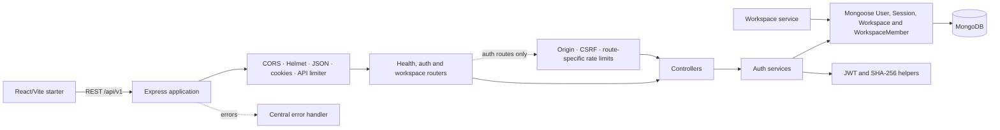
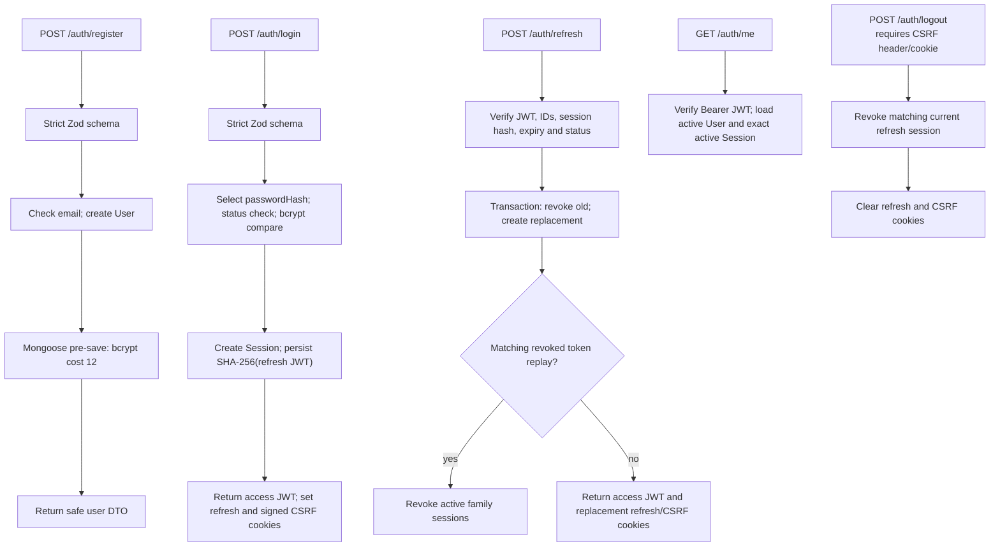

# System Architecture

**Product architecture:** R1 baseline frozen 2026-11-13
**Implementation snapshot:** 2026-11-17

## Contents

- [Style and stack](#style-and-stack)
- [High-level architecture](#high-level-architecture)
- [Frontend architecture](#frontend-architecture)
- [Backend structure](#backend-structure)
- [Request lifecycle](#request-lifecycle)
- [Authentication lifecycle](#authentication-lifecycle)
- [Database interaction](#database-interaction)
- [Product boundaries](#product-boundaries)

## Style and stack

TeamSync uses a modular monolith: one backend application with domain modules, a React/Vite frontend, and MongoDB as the durable source of truth. This keeps local development and deployment straightforward while still making domain responsibilities explicit; microservices are not justified at this stage.

| Layer | Current implementation | Approved/selected but not integrated |
|---|---|---|
| Backend | Node.js ES modules, Express, MongoDB/Mongoose, Zod, bcrypt, jsonwebtoken, dotenv, Helmet, CORS, cookie-parser, express-rate-limit | Socket.IO |
| Frontend | React/Vite/Tailwind CSS v4 starter; Axios and TanStack Query client instances are scaffolded | React Router, Zustand and Lucide React are declared but unused; no router/provider/store, product UI or API/auth integration |
| Testing | Node `node:test`, `node:assert/strict`; the auth/security integration run passed 47 tests on 2026-11-16; four workspace test files were added afterward and are developer-reported as passing | Current full-suite rerun, workspace rollback/slug-collision and broader failure-path verification |

## High-level architecture



## Frontend architecture

The approved feature-oriented organization is:

- `frontend/src/app/`: future router, providers and app-level state.
- `frontend/src/features/`: domain-specific auth, workspace, project, task, notification and chat behavior.
- `frontend/src/components/ui/`, `common/`, `layout/`: reusable primitives and shared composition.
- `frontend/src/pages/`: route-level screens.
- `frontend/src/hooks/`, `lib/`, `styles/`, `assets/`: shared hooks, clients, styles and static assets.

The actual app remains a starter screen. `main.jsx` renders `App` in `StrictMode`; there is no router/provider/store wiring, API call integration, auth UI, or Socket.IO client. Declared libraries and scaffold directories are not completed functionality.

## Backend structure

```text
backend/src/
├── app.js                         Express middleware and route mounts
├── server.js                      DB-first startup and signal shutdown
├── config/env.js                  dotenv + Zod configuration
├── database/connection.js         Mongoose connection
├── middleware/
│   ├── auth.middleware.js         Bearer access-token authentication
│   ├── error.middleware.js        API error mapping
│   ├── origin.middleware.js       Exact trusted-Origin check for auth POST routes
│   ├── csrf.middleware.js         Signed double-submit check for refresh/logout
│   └── rate-limit.middleware.js   In-memory API and auth-route limiters
├── modules/
│   ├── auth/                      routes, controller, schemas, service, Session model
│   ├── health/                    health route/controller
│   ├── users/                     User model
│   └── workspaces/                routes, controller, service, validation and models
└── utils/
    ├── csrf-token.js              HMAC-SHA256 token generation/verification
    ├── token.js                   JWT sign/verify
    └── token-hash.js              SHA-256 refresh-token digest
```

Projects, tasks, notifications and chat directories currently contain placeholders. Workspace management routes are active, with authorization limited to membership-based access and the implemented role checks.

### Module implementation status

| Module | Status | Evidence / limits |
|---|---|---|
| Auth | Implemented; covered by auth/security integration suite | Register/login/refresh/logout and `/me` exist; the nine-file auth/security suite passed 47 tests on 2026-11-16, before workspace files were added. Broader failure paths remain. |
| Health | Implemented | Public health route/controller exist; a prior smoke check returned HTTP 200, but it was not rerun here. |
| Users | Implemented; covered by auth integration tests | User model, bcrypt hook and auth flows exist; registration/hash/DTO behavior is covered. The earlier nine-file auth/security run passed 47 tests on 2026-11-16, before workspace files were added. |
| Workspaces | Implemented management and invitation-creation slice | Authenticated create/list/details/update/soft-delete, accepted-member listing and registered-user invitation creation exist. Four integration files cover creation/listing, details, update and deletion, but do not cover member listing or invitations; the current full suite was not rerun for this documentation update. Invitation acceptance/decline, email delivery, expiry/revocation, member removal, role management, recovery and project/resource authorization remain unimplemented. |
| Projects | Planned / not started | Placeholder directory only; no model, service or routes. |
| Tasks | Planned / not started | Placeholder directory only; no model, service or routes. |
| Notifications | Planned / not started | Placeholder directory only; no model, service or routes. |
| Chat | Planned / not started | Placeholder directory only; no model, service, routes or Socket.IO integration. |
| Database | Implemented but not fully tested | Mongoose connection and User/Session/Workspace/WorkspaceMember schemas exist; live database/index creation was not verified. |
| Middleware | Implemented; selected paths tested | Auth, errors, Origin/CSRF checks, general API rate limiting and auth-route limits exist; the earlier nine-file auth/security run passed 47 tests on 2026-11-16. Rate-limit header behavior and exact CSRF clear-cookie path are not asserted. |
| Frontend | Partially implemented | React/Vite/Tailwind starter plus Axios/Query client instances; no router/provider wiring, product UI, auth flow or API integration. |

### Responsibilities and rationale

| Component | Responsibility | Why it is separate |
|---|---|---|
| Routes | Map HTTP method/path to controller; attach auth middleware where required | Keeps routing declarative |
| Controllers | Parse request schemas, call services, set cookies/statuses, return safe DTOs | Isolates transport-specific behavior |
| Services | Registration/login, refresh-session decisions, and workspace membership, role and invitation-creation rules | Keeps business rules out of routes and persistence hooks |
| Models | Define User, Session, Workspace and WorkspaceMember fields, membership states and index declarations | Centralizes persistence constraints; WorkspaceMember represents accepted/declined memberships and pending invitations |
| Middleware | Authenticate Bearer access requests; map forwarded errors | Reuses cross-cutting behavior across routes |
| Origin middleware | Require the configured frontend Origin on auth POST routes | Rejects missing or untrusted browser origins; it is a CSRF defense, not identity verification |
| Rate-limit middleware | Apply 300 requests/15 minutes to `/api/v1`, plus route limits for login, registration and refresh | Bounds repeated requests; default stores are process-local |
| Config | Load dotenv and validate env once with Zod | Fails early instead of silently running with invalid config |
| Database | Connect with Mongoose | Centralizes connection lifecycle |
| Utilities | Sign/verify JWTs and hash refresh token strings | Reuses narrow, side-effect-limited primitives |

## Request lifecycle

Actual Express order from `backend/src/app.js`:

1. CORS with configured `CLIENT_URL` and credentials.
2. Helmet security headers.
3. JSON body parsing.
4. `cookie-parser`.
5. General IP rate limiter on `/api/v1`, then health/auth/workspace routers; auth routes apply route-specific rate limiting, trusted-Origin and CSRF checks, while workspace creation and invitation creation require trusted Origin and all workspace routes require Bearer authentication.
6. Central error handler for errors forwarded with `next(error)`.

The auth router applies `authenticate` to `GET /me`. Registration, login, refresh and logout require a trusted `Origin`; refresh and logout additionally require a refresh cookie and valid CSRF cookie/header pair. A general 300-per-15-minute IP limit applies to every `/api/v1` request; login, registration and refresh have stricter route limits. `authenticate` verifies both the JWT and its database session. The workspace router is mounted at `/api/v1/workspaces`; every route requires authentication, and create and invitation creation also require trusted Origin. Workspace services require `ACCEPTED` membership for workspace visibility/member listing, OWNER/ADMIN for updates and invitation creation, and OWNER for deletion. These are endpoint-specific checks, not complete member-management or project/resource authorization.

### Workspace membership and invitation creation

`WorkspaceMember` is the authorization relationship between a user and workspace and also stores invitations for registered users. Workspace creation transactionally adds the creator as an `ACCEPTED` OWNER. Invitation creation adds or reuses a row as `PENDING` MEMBER, recording `invitedBy` and clearing acceptance/decline/join timestamps. A declined row can be reset to pending; an accepted membership and a pending invitation are conflicts. The unique `{ workspace: 1, user: 1 }` index backs up the service's duplicate checks against concurrent inserts.

Only `ACCEPTED` membership satisfies the current workspace-access queries. This prevents a pending invite from granting access before the account is explicitly admitted; a signed-in identity alone is not workspace authorization. The current service has no invitation acceptance or decline operation, so the transition out of `PENDING` is not yet available through the API. Token-based invitation, expiration, email delivery, and revocation also remain future work.


### Configuration and startup

`backend/src/config/env.js` imports `dotenv/config`, parses `process.env` using Zod, reports field errors and exits on invalid required configuration. `JWT_ACCESS_SECRET`, `JWT_REFRESH_SECRET`, and `CSRF_SECRET` are required (minimum 32 characters each); `MONGO_URI` is schema-optional but required for successful connection. `CSRF_SECRET` is a dedicated HMAC-SHA256 signing key for the refresh-token-bound double-submit token. `server.js` awaits `connectDB()` before opening the HTTP listener. On SIGINT/SIGTERM it stops the HTTP server and then closes Mongoose. There is no explicit shutdown timeout.

## Authentication lifecycle



The system currently implements this auth/session foundation, Origin validation on the four auth POST routes, signed double-submit CSRF validation on refresh/logout, and in-memory IP rate limits for all API routes plus stricter login/registration/refresh limits. Access-token session checks make session revocation effective immediately on protected requests. It does not implement shared rate-limit storage, explicit production proxy trust, email verification, logout-all-devices or comprehensive workspace/project/resource authorization. The implemented workspace routes perform membership and role checks. The logout controller currently clears the CSRF cookie with a path different from the one used when issuing it; see the [security model](13_SECURITY_AND_ACCESS.md). See the [API reference](07_API_DOCUMENTATION.md) for precise behavior and limitations.

Every access JWT contains `sid`, the `_id` of the database Session created at login or refresh. On protected requests, authentication verifies the JWT (`exp`, issuer, algorithm and token type), loads an active User, then requires the exact matching Session for that user with `revokedAt: null` and `expiresAt` in the future. JWT expiry (15 minutes) and database-session expiry (seven days) are independent limits: either one can deny access first. A valid JWT signature does not override a revoked, missing or expired database Session. Logout revokes only the supplied session, so its access tokens fail the next protected request while another device's session remains active.

## Database interaction

```mermaid
sequenceDiagram
  participant API as Auth service
  participant TX as Mongoose transaction
  participant S as Session collection
  participant U as User collection
  API->>TX: Start refresh rotation
  TX->>S: Find sid + user; select hidden tokenHash
  TX->>TX: Compare SHA-256 and check expiry/revocation
  TX->>U: Confirm account is active
  TX->>S: Conditional update old session (revokedAt, lastUsedAt, replacedBy)
  TX->>S: Insert replacement with same familyId
  TX-->>API: Commit atomically
  Note over TX,S: Failure aborts transaction writes
```

MongoDB transactions require a replica set or sharded deployment. A dedicated test database is required for integration tests. The nine-file auth/security integration run passed 47 tests on 2026-11-16 against the configured disposable test database, before four workspace files were added. The developer reports the workspace regression suite passed, but the current 13-file suite was not independently rerun. The transaction test uses the database named in `MONGO_URI`, so a production/shared URI must never be used for tests. The rate-limit tests verify rejection status/message but do not assert headers; the logout test's `Path=/` match is not a strict assertion of the CSRF clear-cookie path.

Conditional session update claims a refresh session once. If a previously revoked token with a matching stored hash is reused, the service revokes all active sessions sharing its `familyId`; the family identifier itself is not changed. The concurrency test expects one rotation to succeed, the competing request to fail, and the token family to end revoked. These integration tests exist but were not run during this documentation update.

## Product boundaries

The approved R1 modules include auth, users, workspaces, membership, invitations, projects, tasks, comments, notifications, activities, project chat and analytics. Auth, health, workspace management, accepted-member listing, invitation creation, and user/session/workspace persistence have active routes/models. Workspace read/update/delete and invitation-creation roles are enforced for the implemented endpoints. Invitation acceptance/decline, email delivery, expiry/revocation, member removal/role management, ownership transfer, recovery, project/task authorization and broader tenant isolation remain requirements, not implemented capabilities. Calendar, attachments and direct/group messaging are deferred to later releases.
