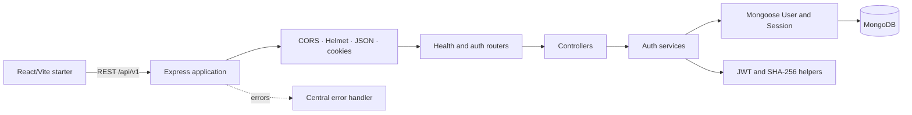
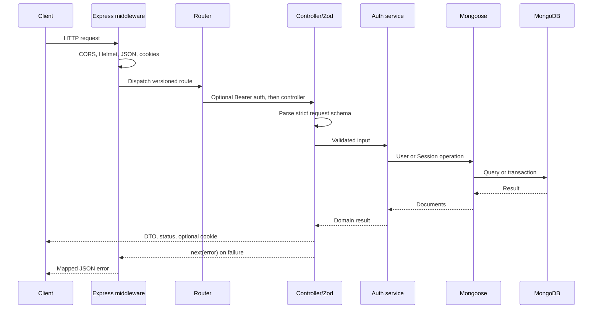
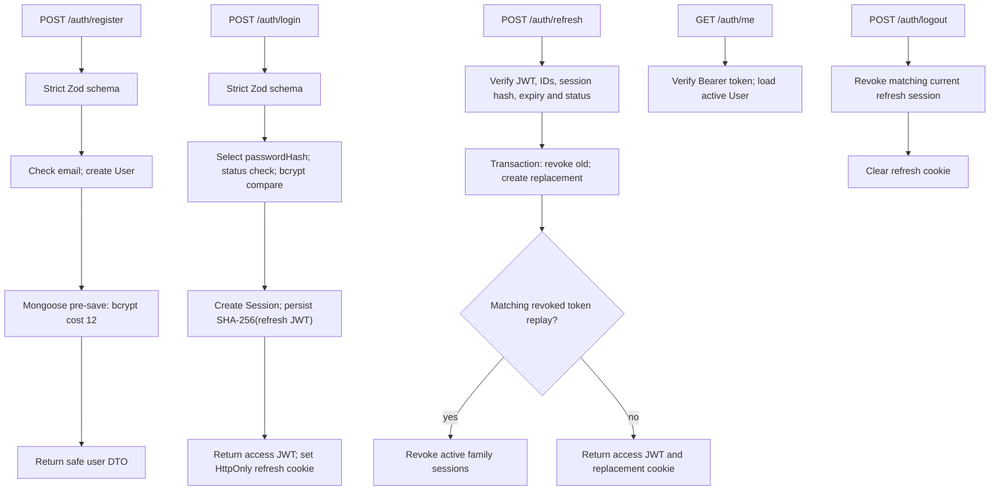

# System Architecture

**Product architecture:** R1 baseline frozen 2026-11-13
**Implementation snapshot:** 2026-11-14

## Contents

- [Style and stack](#style-and-stack)
- [High-level architecture](#high-level-architecture)
- [Frontend architecture](#frontend-architecture)
- [Backend structure](#backend-structure)
- [Request lifecycle](#request-lifecycle)
- [Authentication lifecycle](#authentication-lifecycle)
- [Database interaction](#database-interaction)
- [Product boundaries](#product-boundaries)

## Style and stack

TeamSync uses a modular monolith: one backend application with domain modules, a React/Vite frontend, and MongoDB as the durable source of truth. This keeps local development and deployment straightforward while still making domain responsibilities explicit; microservices are not justified at this stage.

| Layer | Current implementation | Approved/selected but not integrated |
|---|---|---|
| Backend | Node.js ES modules, Express, Mongoose, Zod, bcrypt, jsonwebtoken, dotenv, Helmet, CORS, cookie-parser | Socket.IO |
| Frontend | React, Vite, Tailwind CSS v4 starter | React Router, TanStack Query, Zustand, Axios, Lucide React are declared but not wired into app |
| Testing | Node `node:test`, `node:assert/strict`, MongoDB integration-test files | Additional automated API/security tests |

## High-level architecture



## Frontend architecture

The approved feature-oriented organization is:

- `frontend/src/app/`: future router, providers and app-level state.
- `frontend/src/features/`: domain-specific auth, workspace, project, task, notification and chat behavior.
- `frontend/src/components/ui/`, `common/`, `layout/`: reusable primitives and shared composition.
- `frontend/src/pages/`: route-level screens.
- `frontend/src/hooks/`, `lib/`, `styles/`, `assets/`: shared hooks, clients, styles and static assets.

The actual app remains a starter screen. `main.jsx` renders `App` in `StrictMode`; there is no router/provider/store wiring, API call integration, auth UI, or Socket.IO client. Declared libraries and scaffold directories are not completed functionality.

## Backend structure

```text
backend/src/
├── app.js                         Express middleware and route mounts
├── server.js                      DB-first startup and signal shutdown
├── config/env.js                  dotenv + Zod configuration
├── database/connection.js         Mongoose connection
├── middleware/
│   ├── auth.middleware.js         Bearer access-token authentication
│   └── error.middleware.js        API error mapping
├── modules/
│   ├── auth/                      routes, controller, schemas, service, Session model
│   ├── health/                    health route/controller
│   └── users/                     User model
└── utils/
    ├── token.js                   JWT sign/verify
    └── token-hash.js              SHA-256 refresh-token digest
```

Other product module directories currently contain placeholders.

### Responsibilities and rationale

| Component | Responsibility | Why it is separate |
|---|---|---|
| Routes | Map HTTP method/path to controller; attach auth middleware where required | Keeps routing declarative |
| Controllers | Parse request schemas, call services, set cookies/statuses, return safe DTOs | Isolates transport-specific behavior |
| Services | Registration/login and refresh-session decisions | Keeps business rules out of routes and persistence hooks |
| Models | Define MongoDB fields, indexes and password hooks | Centralizes persistence constraints |
| Middleware | Authenticate Bearer access requests; map forwarded errors | Reuses cross-cutting behavior across routes |
| Config | Load dotenv and validate env once with Zod | Fails early instead of silently running with invalid config |
| Database | Connect with Mongoose | Centralizes connection lifecycle |
| Utilities | Sign/verify JWTs and hash refresh token strings | Reuses narrow, side-effect-limited primitives |

## Request lifecycle

Actual Express order from `backend/src/app.js`:

1. CORS with configured `CLIENT_URL` and credentials.
2. Helmet security headers.
3. JSON body parsing.
4. `cookie-parser`.
5. `/api/v1/health` and `/api/v1/auth` routers.
6. Central error handler for errors forwarded with `next(error)`.

The auth router applies `authenticate` to `GET /me`. Login and registration are public; refresh and logout use the refresh cookie.



### Configuration and startup

`backend/src/config/env.js` imports `dotenv/config`, parses `process.env` using Zod, reports field errors and exits on invalid required configuration. `JWT_ACCESS_SECRET` and `JWT_REFRESH_SECRET` are required (minimum 32 characters each); `MONGO_URI` is schema-optional but required for successful connection. `server.js` awaits `connectDB()` before opening the HTTP listener. On SIGINT/SIGTERM it stops the HTTP server and then closes Mongoose. There is no explicit shutdown timeout.

## Authentication lifecycle



The system currently implements this auth/session foundation, but it does not implement email verification, CSRF/Origin protection, rate limiting, logout-all-devices, or workspace authorization. See the [API reference](07_API_DOCUMENTATION.md) and [security model](13_SECURITY_AND_ACCESS.md) for precise behavior.

## Database interaction

```mermaid
sequenceDiagram
  participant API as Auth service
  participant TX as Mongoose transaction
  participant S as Session collection
  participant U as User collection
  API->>TX: Start refresh rotation
  TX->>S: Find sid + user; select hidden tokenHash
  TX->>TX: Compare SHA-256 and check expiry/revocation
  TX->>U: Confirm account is active
  TX->>S: Conditional update old session (revokedAt, lastUsedAt, replacedBy)
  TX->>S: Insert replacement with same familyId
  TX-->>API: Commit atomically
  Note over TX,S: Failure aborts transaction writes
```

MongoDB transactions require a replica set or sharded deployment. A dedicated test database is required for integration tests. The transaction test uses the database named in `MONGO_URI`, so a production/shared URI must never be used for tests.

Conditional session update claims a refresh session once. If a previously revoked token with a matching stored hash is reused, the service revokes all active sessions sharing its `familyId`; the family identifier itself is not changed. The concurrency test expects one rotation to succeed, the competing request to fail, and the token family to end revoked. These integration tests exist but were not run during this documentation update.

## Product boundaries

The approved R1 modules include auth, users, workspaces, membership, invitations, projects, tasks, comments, notifications, activities, project chat and analytics. Only auth, health and user/session persistence are currently represented by working backend code. Calendar, attachments and direct/group messaging are deferred to later releases. Workspace and project access rules remain requirements, not implemented authorization.
