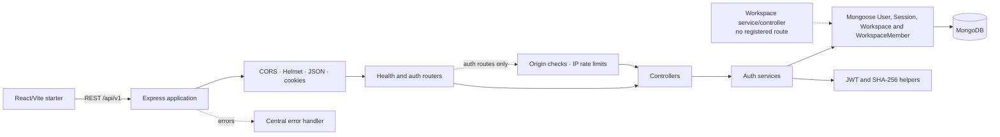
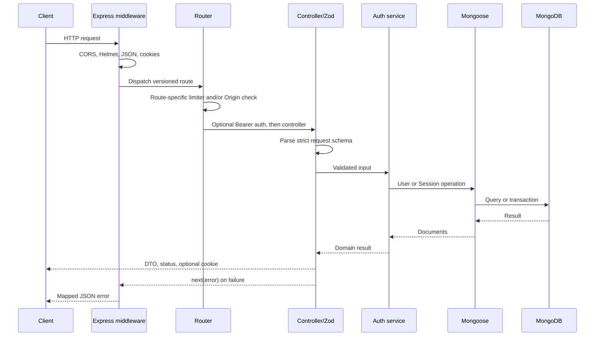
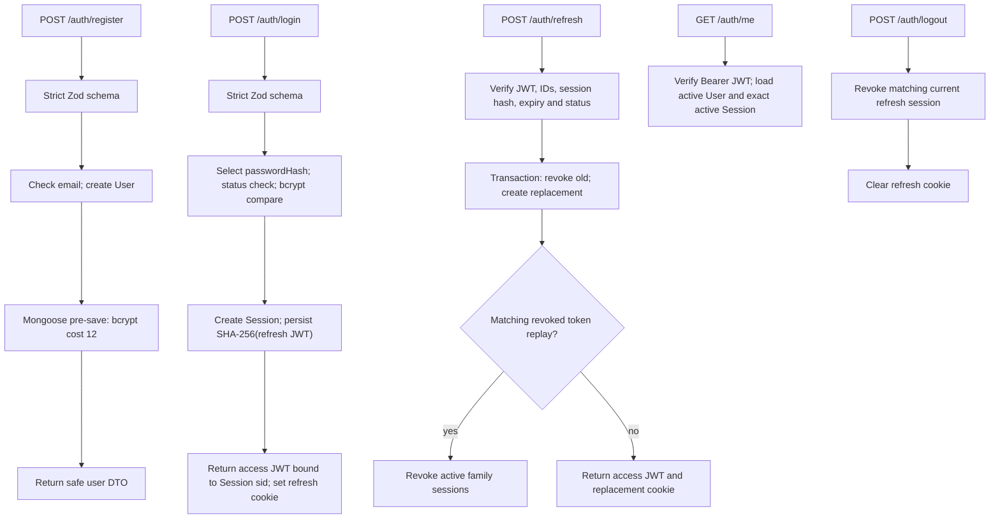

# System Architecture

**Product architecture:** R1 baseline frozen 2026-11-13
**Implementation snapshot:** 2026-11-15

## Contents

- [Style and stack](#style-and-stack)
- [High-level architecture](#high-level-architecture)
- [Frontend architecture](#frontend-architecture)
- [Backend structure](#backend-structure)
- [Request lifecycle](#request-lifecycle)
- [Authentication lifecycle](#authentication-lifecycle)
- [Database interaction](#database-interaction)
- [Product boundaries](#product-boundaries)

## Style and stack

TeamSync uses a modular monolith: one backend application with domain modules, a React/Vite frontend, and MongoDB as the durable source of truth. This keeps local development and deployment straightforward while still making domain responsibilities explicit; microservices are not justified at this stage.

| Layer | Current implementation | Approved/selected but not integrated |
|---|---|---|
| Backend | Node.js ES modules, Express, MongoDB/Mongoose, Zod, bcrypt, jsonwebtoken, dotenv, Helmet, CORS, cookie-parser, express-rate-limit | Socket.IO |
| Frontend | React/Vite/Tailwind CSS v4 starter; Axios and TanStack Query client instances are scaffolded | React Router, Zustand and Lucide React are declared but unused; no router/provider/store, product UI or API/auth integration |
| Testing | Node `node:test`, `node:assert/strict`, six integration files covering transaction, auth HTTP/service and rate limits | Workspace tests, successful refresh-controller HTTP tests and broader security/failure paths |

## High-level architecture



## Frontend architecture

The approved feature-oriented organization is:

- `frontend/src/app/`: future router, providers and app-level state.
- `frontend/src/features/`: domain-specific auth, workspace, project, task, notification and chat behavior.
- `frontend/src/components/ui/`, `common/`, `layout/`: reusable primitives and shared composition.
- `frontend/src/pages/`: route-level screens.
- `frontend/src/hooks/`, `lib/`, `styles/`, `assets/`: shared hooks, clients, styles and static assets.

The actual app remains a starter screen. `main.jsx` renders `App` in `StrictMode`; there is no router/provider/store wiring, API call integration, auth UI, or Socket.IO client. Declared libraries and scaffold directories are not completed functionality.

## Backend structure

```text
backend/src/
├── app.js                         Express middleware and route mounts
├── server.js                      DB-first startup and signal shutdown
├── config/env.js                  dotenv + Zod configuration
├── database/connection.js         Mongoose connection
├── middleware/
│   ├── auth.middleware.js         Bearer access-token authentication
│   ├── error.middleware.js        API error mapping
│   ├── origin.middleware.js       Exact trusted-Origin check for auth POST routes
│   └── rate-limit.middleware.js   In-memory login/register/refresh limiters
├── modules/
│   ├── auth/                      routes, controller, schemas, service, Session model
│   ├── health/                    health route/controller
│   ├── users/                     User model
│   └── workspaces/                Workspace/member models, validation, create service and controller; no routes
└── utils/
    ├── token.js                   JWT sign/verify
    └── token-hash.js              SHA-256 refresh-token digest
```

Projects, tasks, notifications and chat directories currently contain placeholders. Workspace code implements a limited creation slice but is not exposed through a route.

### Module implementation status

| Module | Status | Evidence / limits |
|---|---|---|
| Auth | Implemented but not fully tested | Register/login/refresh/logout and `/me` exist; six test files contain relevant assertions, but were not run for this documentation update. |
| Health | Implemented | Public health route/controller exist; a prior smoke check returned HTTP 200, but it was not rerun here. |
| Users | Implemented but not fully tested | User model, bcrypt hook and auth flows exist; test assertions cover registration/hash/DTO behavior, but pass status is unverified. |
| Workspaces | Partially implemented | Models, create validation, transaction service and controller exist; no routes, integration tests, membership authorization or tenant isolation. |
| Projects | Planned / not started | Placeholder directory only; no model, service or routes. |
| Tasks | Planned / not started | Placeholder directory only; no model, service or routes. |
| Notifications | Planned / not started | Placeholder directory only; no model, service or routes. |
| Chat | Planned / not started | Placeholder directory only; no model, service, routes or Socket.IO integration. |
| Database | Implemented but not fully tested | Mongoose connection and User/Session/Workspace/WorkspaceMember schemas exist; live database/index creation and workspace transaction tests were not verified. |
| Middleware | Implemented but not fully tested | Auth, errors, Origin checks and rate limits exist; HTTP assertions cover some paths, but tests were not run and auth failure paths remain incomplete. |
| Frontend | Partially implemented | React/Vite/Tailwind starter plus Axios/Query client instances; no router/provider wiring, product UI, auth flow or API integration. |

### Responsibilities and rationale

| Component | Responsibility | Why it is separate |
|---|---|---|
| Routes | Map HTTP method/path to controller; attach auth middleware where required | Keeps routing declarative |
| Controllers | Parse request schemas, call services, set cookies/statuses, return safe DTOs | Isolates transport-specific behavior |
| Services | Registration/login, refresh-session decisions, and transactional workspace creation | Keeps business rules out of routes and persistence hooks |
| Models | Define User, Session, Workspace and WorkspaceMember fields/index declarations | Centralizes persistence constraints |
| Middleware | Authenticate Bearer access requests; map forwarded errors | Reuses cross-cutting behavior across routes |
| Origin middleware | Require the configured frontend Origin on auth POST routes | Rejects missing or untrusted browser origins; it is a CSRF defense, not identity verification |
| Rate-limit middleware | Apply IP-based limits to login, registration and refresh | Bounds repeated requests; the configured default store is process-local |
| Config | Load dotenv and validate env once with Zod | Fails early instead of silently running with invalid config |
| Database | Connect with Mongoose | Centralizes connection lifecycle |
| Utilities | Sign/verify JWTs and hash refresh token strings | Reuses narrow, side-effect-limited primitives |

## Request lifecycle

Actual Express order from `backend/src/app.js`:

1. CORS with configured `CLIENT_URL` and credentials.
2. Helmet security headers.
3. JSON body parsing.
4. `cookie-parser`.
5. `/api/v1/health` and `/api/v1/auth` routers; auth route middleware applies rate limiting and/or trusted-Origin checks before controllers.
6. Central error handler for errors forwarded with `next(error)`.

The auth router applies `authenticate` to `GET /me`. Registration, login, refresh and logout require a trusted `Origin`; refresh and logout use the refresh cookie. Login, registration and refresh also have IP-based rate limits. `authenticate` verifies both the JWT and its database session. Workspace controller/service code is not mounted: there is no workspace routes file or active workspace API.



### Configuration and startup

`backend/src/config/env.js` imports `dotenv/config`, parses `process.env` using Zod, reports field errors and exits on invalid required configuration. `JWT_ACCESS_SECRET` and `JWT_REFRESH_SECRET` are required (minimum 32 characters each); `MONGO_URI` is schema-optional but required for successful connection. `server.js` awaits `connectDB()` before opening the HTTP listener. On SIGINT/SIGTERM it stops the HTTP server and then closes Mongoose. There is no explicit shutdown timeout.

## Authentication lifecycle



The system currently implements this auth/session foundation, Origin validation on the four auth POST routes and in-memory IP rate limits for login, registration and refresh. Access-token session checks make session revocation effective immediately on protected requests. It does not implement email verification, a CSRF token mechanism, shared rate-limit storage, logout-all-devices or workspace authorization. See the [API reference](07_API_DOCUMENTATION.md) and [security model](13_SECURITY_AND_ACCESS.md) for precise behavior and limitations.

Every access JWT contains `sid`, the `_id` of the database Session created at login or refresh. On protected requests, authentication verifies the JWT (`exp`, issuer, algorithm and token type), loads an active User, then requires the exact matching Session for that user with `revokedAt: null` and `expiresAt` in the future. JWT expiry (15 minutes) and database-session expiry (seven days) are independent limits: either one can deny access first. A valid JWT signature does not override a revoked, missing or expired database Session. Logout revokes only the supplied session, so its access tokens fail the next protected request while another device's session remains active.

## Database interaction

```mermaid
sequenceDiagram
  participant API as Auth service
  participant TX as Mongoose transaction
  participant S as Session collection
  participant U as User collection
  API->>TX: Start refresh rotation
  TX->>S: Find sid + user; select hidden tokenHash
  TX->>TX: Compare SHA-256 and check expiry/revocation
  TX->>U: Confirm account is active
  TX->>S: Conditional update old session (revokedAt, lastUsedAt, replacedBy)
  TX->>S: Insert replacement with same familyId
  TX-->>API: Commit atomically
  Note over TX,S: Failure aborts transaction writes
```

MongoDB transactions require a replica set or sharded deployment. A dedicated test database is required for integration tests. The transaction test uses the database named in `MONGO_URI`, so a production/shared URI must never be used for tests.

Conditional session update claims a refresh session once. If a previously revoked token with a matching stored hash is reused, the service revokes all active sessions sharing its `familyId`; the family identifier itself is not changed. The concurrency test expects one rotation to succeed, the competing request to fail, and the token family to end revoked. These integration tests exist but were not run during this documentation update.

## Product boundaries

The approved R1 modules include auth, users, workspaces, membership, invitations, projects, tasks, comments, notifications, activities, project chat and analytics. Auth, health and user/session persistence have active routes/models; workspace creation has a transactional service/controller/model slice but is not mounted or tested. Workspace role enforcement, invitations, project/task authorization and tenant isolation remain requirements, not implemented access controls. Calendar, attachments and direct/group messaging are deferred to later releases.
